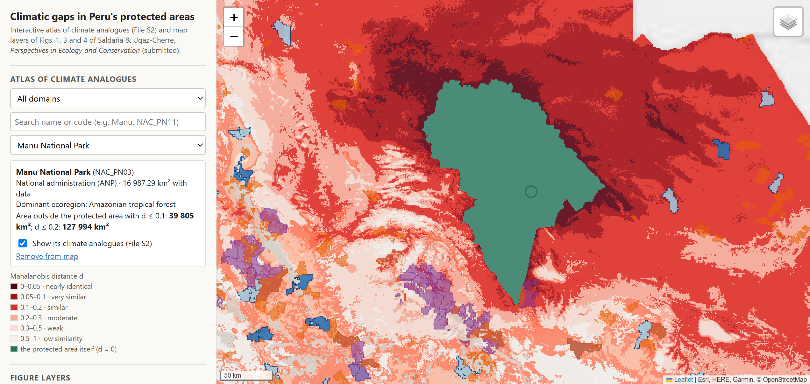

# Climatic gaps in Peru's protected-area network

[](https://doi.org/10.5281/zenodo.23753927)

Code, derived data, figures and supplementary tables for:

> Saldaña, I.S., Ugaz-Cherre, A. Protected-area networks can represent climate worse than chance, and threatened-species plans toward 30×30 need climatic targets to close the gaps: evidence from Peru. *Perspectives in Ecology and Conservation* (submitted).

## Interactive atlas

**https://irwingss.github.io/peru-climatic-gaps/**

[](https://irwingss.github.io/peru-climatic-gaps/)

The analogue map of each of the 258 protected areas on land and of the six maritime areas (File S2), and the map layers of Figs. 1, 3 and 4, in a Leaflet viewer. Protected-area outlines are drawn from the SERNANP official cadastre as map tiles; the original vectors are not redistributed.

## About

For every 30″ pixel of continental Peru and every 0.05° pixel of its 200-nautical-mile sea, the analysis measures the regularized Mahalanobis distance to the most similar climate inside any of the 259 protected areas of the official cadastre (ANP, ACR and ACP). It then tests the network against 999 null networks that keep each area's size, shape, natural setting and ecoregion mix (the context-preserving design, called N2c in the code and in Supplementary material S1), estimates the natural surface needed to close the climatic gaps, and compares species-led and climate-led prioritizations with prioritizr.

Code comments and some file and column names are in Spanish; the paper, figures and tables are in English.

## Contents

| Folder | What it holds |
|---|---|
| `clima_local/` | Analysis pipeline: inputs, climate metric, exact analogue search, null networks and their magnitude, aggregation and redundancy, natural mask, precipitation bias test, present-day test of the future-compatible variables, expansion effort, prioritization (with `prioritizacion.R`) and two self-checks (`test_p.py`, `test_huellas.py`) |
| `especies_uicn/` | Overlap of IUCN Red List and BirdLife ranges with the climatic gaps |
| `figuras_tablas/` | Numbers of the text (`cifras_resultados.py`), figures of the article (`figuras_articulo.py`), supplementary figures (`figuras_suplementarias.py`, `flujogramas/`), species results (`especies.py`), File S2 atlas (`atlas.py`, `tabla_s1_datos.py`) and File S3 maps (`mapas_especies.py`); shared helpers in `figuras_comun.py` |
| `figures/main/` | Figs. 1–4 (600 dpi PNG) and the graphical abstract (300 dpi PNG) |
| `figures/supplementary/` | Figs. S1–S13 |
| `tables/` | Tables S1–S24 of the Supplementary material and the table behind Fig. 4, as CSV |
| `supplementary/` | File S1, per-species results (IUCN and BirdLife groups) |
| `docs/` | Web atlas viewer (GitHub Pages, Leaflet): the analogue map of every protected area (File S2) and the map layers of Figs. 1, 3 and 4; layers in `docs/capas/`, written by `figuras_tablas/visor_datos.py` |
| `data/` | Derived data behind every number of the article (see below) and `insumos_sha256.json`, the SHA-256 of every input file used |

File S2 (atlas, about 1 GB with its GeoTIFFs) and File S3 (species maps, derived from IUCN and BirdLife ranges) are distributed with the article; `atlas.py` and `mapas_especies.py` rebuild them in `figuras_tablas/figuras/`, outside git.

## Input data

| Data | Source | How it is obtained | Terms |
|---|---|---|---|
| Climate | CHELSA V2.1, 1981–2010 (Karger et al. 2017; Brun et al. 2022) | `descargar_chelsa.py` (Peru windows by HTTP range requests) | CC BY 4.0 |
| Ocean | Bio-ORACLE v3.0, 2000–2019 (Assis et al. 2024) | `ejecutar_marino.py --fase descargar` (ERDDAP) | CC BY 4.0 |
| 200-nautical-mile limit | Flanders Marine Institute (2023), MRGID 8432 | `ejecutar_marino.py --fase descargar` (WFS) | CC BY 4.0 |
| Land cover | MapBiomas Peru, collection 3, 2020 | `mascara_natural.py --fase descargar` (Earth Engine account) | provider's terms |
| Settlements | GHS-SMOD R2023A, 2020 (Schiavina et al. 2023) | `descargar_insumos.py` | CC BY 4.0 |
| Elevation | WorldClim 2.1, 30″ | `descargar_insumos.py` | provider's terms |
| Rainfall reference | PISCOp v3.0 (Gutierrez & Lavado-Casimiro 2026, doi:10.6084/m9.figshare.32411886.v1) | `descargar_insumos.py` | GPL-3.0 |
| Stations | SENAMHI 1981–2010 normals (WMO template, NOAA NCEI archive) | `descargar_insumos.py` | provider's terms |
| Microbasins | HydroBASINS v1c, level 12 (Lehner & Grill 2013) | `descargar_insumos.py` | provider's terms |
| Protected areas | SERNANP, Catastro Oficial de Áreas Naturales Protegidas (cadastre of 9 October 2026) | manual, from https://geo.sernanp.gob.pe | no redistribution of the original data |
| Ecoregions | MINAM (2017), Mapa de Ecorregiones del Perú | manual, from https://geoservidor.minam.gob.pe | free access; no licence for redistribution found |
| Departments | INEI | manual, from https://ide.inei.gob.pe | no licence for redistribution found |
| Species | IUCN Red List spatial data 2026-1; BirdLife International and HBW (2025) | on request from each provider | non-commercial use, no redistribution |

The SERNANP, MINAM and INEI files are not included because their terms do not grant redistribution; the IUCN and BirdLife ranges cannot be redistributed. Inputs go in the folder pointed to by `RECURSOS_GENERALES` (default `~/Documents/Recursos generales`), and the MINAM ecoregions and HydroBASINS in `SIG_DIR`; `data/insumos_sha256.json` gives the path, size and SHA-256 of each file. The country outlines of the maps (`figuras_tablas/insumos_figuras/paises.geojson`) are Natural Earth 1:10m, public domain, and the department outlines are derived from the INEI polygons when a figure needs them.

## Reproducing the analysis

Requirements: Python 3.13 (`requirements.txt`), R 4.6 with prioritizr 9.0 and highs, Chrome or Edge for the two workflow figures, and an Earth Engine account for the natural mask. Run the commands from the repository root. Scripts write their outputs in `resultados_climaticos/`, `resultados_marinos/`, `resultados_v7/` and `especies_uicn/resultados/` (ignored by git); `data/` holds copies of the outputs behind the article. Random processes use fixed seeds derived from 20261011.

```bash
# 0. Inputs: downloads and check against the files used for the article
python clima_local/descargar_chelsa.py
python clima_local/descargar_chelsa.py --pr-mensual
python clima_local/ejecutar_marino.py --fase descargar
python clima_local/mascara_natural.py --fase descargar
python clima_local/descargar_insumos.py              # GHS-SMOD, WorldClim, PISCOp, SENAMHI, HydroBASINS; then checks every input
# 1. Continental metric, exact distances and maps (distances take about 1 h in one thread)
python clima_local/ejecutar_investigacion.py --fase preparar
python clima_local/ejecutar_investigacion.py --fase fichas
python clima_local/ejecutar_investigacion.py --fase distancias
python clima_local/ejecutar_investigacion.py --fase zonas
python clima_local/ejecutar_investigacion.py --fase ecorregiones
python clima_local/ejecutar_investigacion.py --fase mapas
python clima_local/ejecutar_investigacion.py --fase estaciones
# 2. Maritime domain (sea surface and seafloor)
python clima_local/ejecutar_marino.py --fase todo
# 3. Natural mask and precipitation bias test with PISCOp v3.0 (also draws Fig. S9, cociente_chelsa_pisco.png)
python clima_local/mascara_natural.py --fase mascara
python clima_local/sesgo_precipitacion.py --fase corregir
python clima_local/sesgo_precipitacion.py --fase comparar
# 4. Null networks N2c, 999 per domain (about 2.7 h on land), and the aggregation and redundancy of the same networks
O=resultados_v7/02_sesgo_precipitacion/original; M=resultados_v7/03_mascara_natural
python clima_local/ejecutar_investigacion.py --fase factibilidad --out $O --mascara $M --dst resultados_v7/04_redes_nulas/continental
python clima_local/ejecutar_investigacion.py --fase cobertura --diseno N2c --limitar-superposicion --out $O --mascara $M \
  --dst resultados_v7/04_redes_nulas/continental_superposicion_limitada/N2c
python clima_local/ejecutar_marino.py --fase factibilidad --out resultados_v7/04_redes_nulas
python clima_local/ejecutar_marino.py --fase cobertura --diseno N2c --out resultados_v7/04_redes_nulas
python clima_local/agregacion_nulas.py                # about 2.1 h
# 5. Robustness (κ ≤ 50, areas < 1 km²) and present-day test of the 7 future-compatible variables
bash clima_local/robustez.sh
python clima_local/puente_c7.py
# 6. Expansion effort, potential sites, role of each tier, leave-one-out at sea, sensitivity to the 0.2 cut-off
for p in p2 p1 p1_curva p1_validar p1_sitios p3; do python clima_local/implicaciones.py $p; done
python clima_local/umbral_esfuerzo.py                 # about 30 min
# 7. Species ranges and prioritization
python especies_uicn/cruce_uicn.py AMPHIBIANS MAMMALS REPTILES PLANTS MARINEFISH BIRDS
python clima_local/prioritizacion.py preparar
Rscript clima_local/prioritizacion.R
python clima_local/prioritizacion.py evaluar
python clima_local/azar_prioritizacion.py             # 999 random sets at equal area (Fig. 4, Table S11)
for e in A B C17 D10 D17 D30; do python clima_local/azar_prioritizacion.py minimo $e; done
python clima_local/azar_prioritizacion.py juntar      # 999 random sets for the minimum-set solutions (Table S13)
python clima_local/sensibilidad_especies.py           # flat species targets and F(0.2) (Table S12)
# 8. Numbers, figures and supplementary files
python figuras_tablas/cifras_resultados.py
python clima_local/magnitud_nulas.py                  # magnitude of the departure from the null networks (Table S4)
python figuras_tablas/especies.py
python figuras_tablas/tabla_s1_datos.py
python figuras_tablas/figuras_articulo.py             # Figs. 1-4, graphical abstract -> figures/main
python figuras_tablas/figuras_suplementarias.py       # Figs. S1, S4-S8, S10-S13 -> figures/supplementary
python figuras_tablas/atlas.py                        # File S2 -> figuras_tablas/figuras/atlas
python figuras_tablas/mapas_especies.py               # File S3 -> figuras_tablas/figuras/especies
python figuras_tablas/visor_datos.py                  # web viewer layers -> docs/capas (GitHub Pages: branch main, folder /docs)
python figuras_tablas/visor_datos.py teselas          # protected-area outlines as map tiles (SERNANP authorizes derived maps, not its vectors)
python figuras_tablas/flujogramas_datos.py
python figuras_tablas/flujogramas/exportar.py figuras_tablas/flujogramas/fig02_flujo.html figures/supplementary/FigS2_workflow
python figuras_tablas/flujogramas/exportar.py figuras_tablas/flujogramas/fig03_busqueda.html figures/supplementary/FigS3_analogue_search
```

Self-checks: `python clima_local/test_p.py` and `python clima_local/test_huellas.py`.

## Derived data

| File | Description | Article |
|---|---|---|
| `data/metric/` | Climate metric of each domain or layer: transformations, national means and SDs, correlation matrix, λ and condition number (κ ≤ 100; κ ≤ 50 on land) | 2.2, Table S1 |
| `data/rasters/dmin_continental_30s.tif`, `dmin_sea_surface_0p05.tif`, `dmin_seafloor_0p05.tif` | d_min, Mahalanobis distance to the most similar protected climate; 0 inside protected areas | Fig. 1 |
| `data/rasters/natural_mask_30s.tif` | 1 natural, 0 not natural, 255 outside the domain (MapBiomas Peru collection 3, 2020, and GHS-SMOD 2020) | 2.3 |
| `data/null_networks/` | Tests against the 999 N2c null networks (`p_mediana.csv`: D̄ real and null, two-sided p, SES, Holm p, direction), coverage curves, footprint diagnostics, feasibility, magnitude (`magnitud_N2c.json`), aggregation and redundancy (`agregacion_N2c/`), and the robustness runs with κ ≤ 50 and without areas < 1 km² | Fig. 2, Figs. S7–S8, Tables S2–S6 |
| `data/robustness/` | CHELSA vs PISCOp ratio by ecoregion, original vs corrected comparison, present-day comparison of the 11- and 7-variable metrics | Tables S7, S9 |
| `data/stations/` | CHELSA against the 22 SENAMHI stations | Fig. S11, Table S8 |
| `data/rasters/climatic_gaps_expandable_30s.tif` | 1–4, climatic gap on natural land with d_min 0.2–0.3, 0.3–0.5, 0.5–1, > 1; 5, gap on transformed land or city; 0, not a gap; 255, no data | Fig. 3a |
| `data/expansion/` | Effort curve and its targets by ecoregion and department, expandable gaps, role of ANP, ACR and ACP, leave-one-out at sea, and the curve read with cut-offs from 0.15 to 0.3 (`P1_umbral_*`) | Fig. 3, Tables S14–S16, S24 |
| `data/potential_sites/` | 223 potential sites (GeoPackage, CSV, GeoTIFF) with the target they first serve, ecoregion, departments, elevation, share of gap and nearest protected area | Fig. 3a |
| `data/prioritization/` | prioritizr inputs (`entrada/`: planning units, features and amounts), solutions (`solucion_<scenario>.csv`), solver status and HiGHS logs, evaluation, random sets and the target-rule sensitivity (`sensibilidad_metas.*`) | Fig. 4, Tables S11–S13 |
| `data/cifras.json` | Every number quoted in the text and the descriptive tables, as written by `cifras_resultados.py` | Tables S17–S23 |
| `data/insumos_sha256.json` | Path, size and SHA-256 of every input file | |

The full intermediate arrays (prepared climate, per-area distances, the 999 null networks of each domain, about 7.5 GB) are rebuilt by the pipeline; the largest single file, the continental null networks, takes 169 MB.

## Licence

Code: MIT (`LICENSE`). Figures, tables and derived data: CC BY 4.0, except the files derived from IUCN and BirdLife ranges, which are CC BY-NC 4.0 (`LICENSE-DATA.md`). Third-party inputs keep their own terms.

## Citation

See `CITATION.cff`. Please cite the article and the archived version of this repository: Saldaña, I.S., Ugaz-Cherre, A. (2026). Climatic gaps in Peru's protected-area network: code, derived data and supplementary material (v1.0.0). Zenodo. https://doi.org/10.5281/zenodo.23753928. The DOI https://doi.org/10.5281/zenodo.23753927 always resolves to the latest version.
